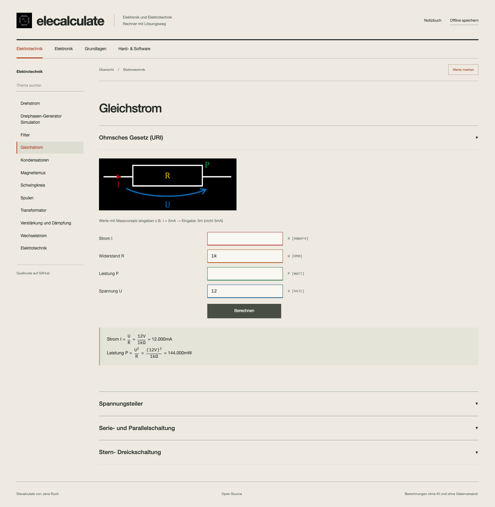

# Elecalculate

Electronics and electrical-engineering calculators with worked solutions, created
by Jana Ruch. This is the complete application migrated from the original HTML
site to TanStack Start. The newer development branch, including its Qubit
simulation, supplies the source baseline.

[Open Elecalculate](https://elecalculate.com)



The site has 31 subject pages covering DC and AC circuits, filters, transformers,
magnetism, capacitors, inductors, resonant circuits, operational amplifiers,
transistor switches, materials, preferred resistor values, resistor colour codes,
digital logic and programming references. The Qubit demonstration includes its
interactive Bloch sphere, gates, custom rotations and measurement.

The content project is being sunset. Existing calculators remain available.
Pages that were unfinished in the original, including FETs and active filters,
remain explicitly unfinished.

## Stack

| Layer                         | Implementation                                           |
| ----------------------------- | -------------------------------------------------------- |
| Runtime and package manager   | Bun 1.4.4                                                |
| Application and routing       | TanStack Start 1.169.4, Router 1.170.46, React 19.3.1    |
| Remote and asynchronous state | TanStack Query 5.104.5                                   |
| Notebook form                 | TanStack Form 1.33.5                                     |
| Styling                       | Tailwind CSS 4.3.3 with subject-specific document styles |
| Typed application code        | TypeScript 7.0.2                                         |
| Local database                | Drizzle ORM 1.0.0-rc.5 and PGlite 0.5.11 in a Web Worker |
| Mathematics and 3D            | Locally bundled KaTeX and Three.js                       |
| Build                         | Vite 8.3.5 with full static prerendering                 |

Dependencies are pinned exactly. Drizzle and Drizzle Kit intentionally use the
same reviewed release candidate. Package versions were checked against the npm
registry during the migration. Architecture references:
[TanStack prerendering](https://tanstack.com/start/latest/docs/framework/react/guide/static-prerendering),
[Tailwind with Vite](https://tailwindcss.com/docs/installation/using-vite),
[PGlite workers](https://pglite.dev/docs/multi-tab-worker), and
[Drizzle PostgreSQL](https://orm.drizzle.team/docs/get-started).

## Run locally

```sh
bun install --frozen-lockfile
bun run dev
```

Open `http://127.0.0.1:4317`. The server refuses an occupied port.

For the actual GitHub Pages build:

```sh
bun run build
bun run start
```

`dist/client` is the complete deployable site. No application server or hosted
database is required. `dist/server` is used only during prerendering.

## Verify

```sh
bunx playwright install chromium
bun run verify
```

Checks exercise every subject route on desktop and mobile, compare calculator
results against the original source, independently check corrected voltage
dividers, operate the Qubit controls and resistor selectors, test notebook
persistence and multi-tab access, and revisit every page with networking disabled.
Representative rendered views are written to `test-results`.

## Offline use and saved work

Choose **Offline speichern** once while online. The entire built application,
including diagrams, the PDF, fonts, mathematical typesetting and PostgreSQL WASM,
is cached. An initial offline installation downloads approximately 23 MB.

**Werte merken** saves the current calculator inputs and a note in a PostgreSQL
database persisted to this browser's IndexedDB. The notebook can restore inputs
and undo removal. It works offline. Clearing browser storage removes these local
records. There is no account, cloud sync or transmission of calculation data.

Serve the build over HTTPS or localhost. Opening the exported HTML with
`file://` does not run a module application or service worker.

## Repository layout

- `src/routes/`: TanStack routes and metadata.
- `src/pages/`: native React pages for every original subject.
- `src/calculations/`: isolated calculation modules and shared helpers.
- `src/lib/`: typed SI parsing, dependency solving, lifecycle and notebook logic.
- `src/db/` and `drizzle/`: PostgreSQL schema, worker and bundled migrations.
- `migration/`: source provenance, full coverage inventory and retired heads.
- `scripts/migrate-source.ts`: reproducible source-to-JSX port.
- `scripts/postbuild.ts`: static compatibility URLs and offline generation.

The established algorithms remain JavaScript modules where appropriate; this is
not a claim that every historical formula has been rewritten in TypeScript.
They run inside a mount-scoped lifecycle rather than global script tags.
There are no iframe calculator wrappers, archive-only calculator fallbacks,
runtime CDN dependencies, or AI calculation services.

## Branches and deployment

`main` is the sole source branch. `gh-pages` contains the verified static build
for the existing `elecalculate.com` custom domain. CI tests before publishing.
Old `.html` URLs redirect to the corresponding migrated routes.

Former branch heads are retained as annotated `sunset/2026-10-25/*` tags. Exact
commits and names are in `migration/branch-snapshots.json`. To recover a retired
branch locally:

```sh
git switch -c recovered-development sunset/2026-10-25/development
```

See [AGENTS.md](AGENTS.md) for operational guidance and
[migration/README.md](migration/README.md) for migration boundaries and corrections.
